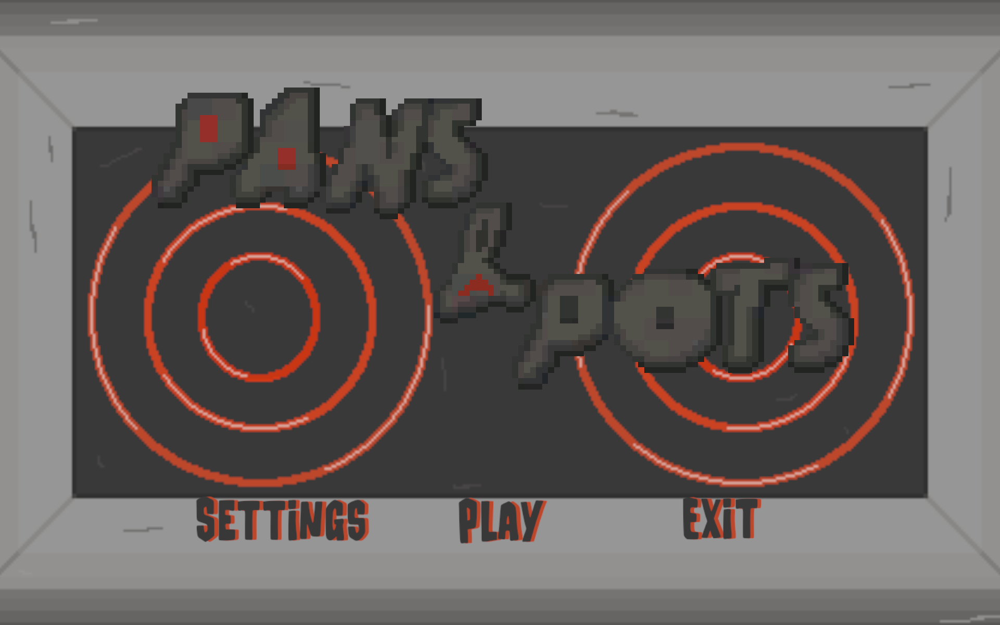
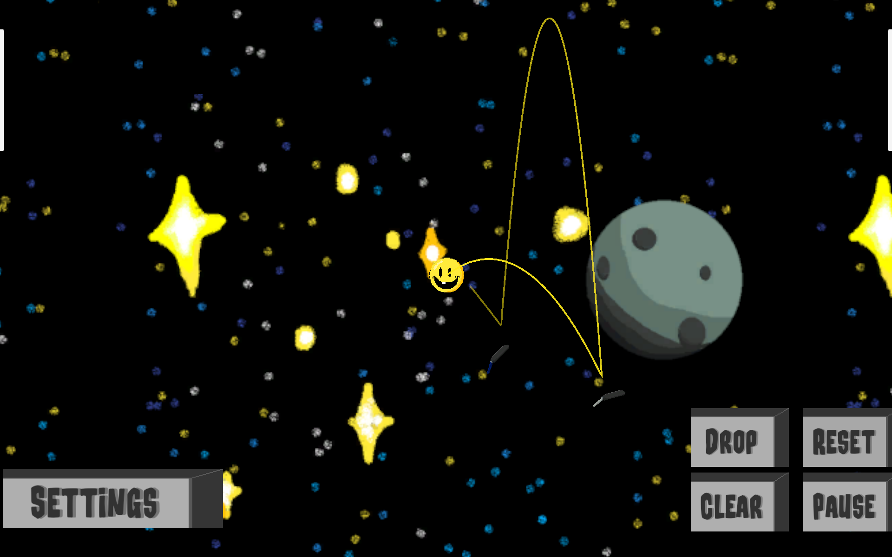

# Pans & Pots

Pans & Pots is a game created for the Haven game jam.

It combines the TikTok videos where someone throws a ping pong ball at a pan to see where it lands, with the videos of a ball rolling and making sounds while it falls. Pick a ball, place pots and pans, and drop it. Each one has its own bounce and sound.

Hope you like it!

## Link

Play it here: [itch.io](https://nicormu.itch.io/pans-and-pots)

## Screenshots

## Controls

| Action | Control |
|---|---|
| Place cookware | Left click |
| Rotate cookware | Mouse wheel |
| Cancel placing | Right click / Esc |
| Aim the ball | Q / E |
| Move camera | WASD / Arrow keys / Middle mouse drag |
| Zoom | Mouse wheel |

## Credits

- Nicolas Rojas
- Juan Andres Granados
- Mauricio Ibañez